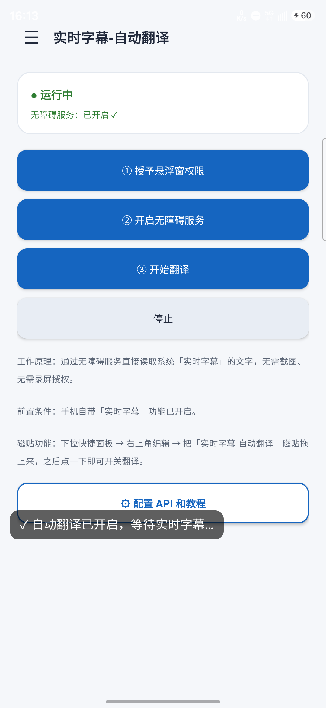
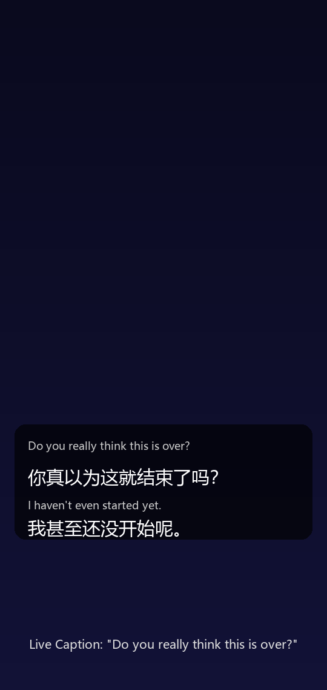
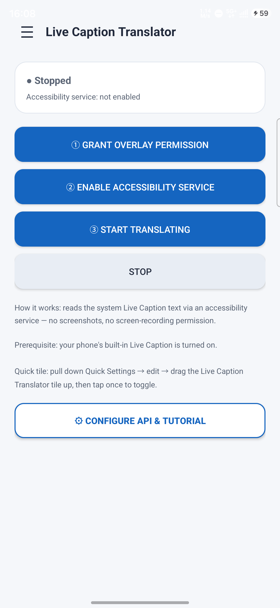

# samsung-live-caption-translator

**[中文](#中文) | [English](#english)**

📦 **下载 / Download**: [**最新 APK (Releases)**](https://github.com/b1aNaa/samsung-live-caption-translator/releases/latest) · 已签名，也可自行从源码构建

---

## 中文

把三星（以及搭载 Google Live Caption 的）手机**系统实时字幕**翻译成中文的悬浮窗工具。

手机自带的实时字幕能精准识别视频语音并显示外文字幕，但不提供翻译。本应用通过**无障碍服务直接读取字幕文字**，交给翻译 API，再把中文译文显示在可拖动的悬浮窗上——**不需要截图、不需要录屏权限、不受 DRM 影响**（Netflix/Disney+ 也能用）。

### 特性

- **无障碍直读**：读取 `com.google.android.as` 字幕窗口的文字节点，零 OCR 误差
- **三个翻译引擎**：

  | 引擎 | 类型 | 特点 |
  |---|---|---|
  | 百度翻译 API | 普通机翻 | 最快、配置最简单、个人使用免费 |
  | Qwen-MT-Lite | 专用翻译模型 | 综合体验最好，免费额度用完后付费（¥0.6 / ¥1.6 每百万字符）|
  | DeepSeek | 通用大语言模型 | 理解力最强，但较慢、需充值 |

- **智能调度**：字幕稳定后 0.4–0.5s 提交翻译；连续讲话时每 1.5s 兜底刷新一次，不再干等气口
- **按行对齐**：保留原字幕分行结构翻译，译文不挤成一团
- **悬浮窗**：可拖动（位置记忆）、字号/透明度/原文显示可调
- **快捷磁贴**：下拉面板一键开关
- **中英双语界面**：跟随系统语言，也可在设置页右上角点「中 / EN」手动切换
- **暗夜模式**：主界面右上角 🌙 一键切换，设置页同步生效
- **可审计**：仅 ~1000 行 Kotlin、3 个依赖、2 个权限、无任何埋点或后台上传

### 截图

| 主界面 | 翻译悬浮窗效果 |
|---|---|
|  |  |

### 适用设备

三星 Galaxy S/Note/Z/A 中高端机型、Google Pixel 及其他内置 Google 实时字幕（Live Caption）的设备，Android 11+。国行小米/OPPO/vivo 等没有 Google 实时字幕，不适用。

### 使用方法

1. **配置 API**（应用内「⚙ 配置 API 和教程」→ 选引擎填密钥）：
   - 百度：<https://fanyi-api.baidu.com> → 通用文本翻译 → APPID + 密钥
   - Qwen：<https://bailian.console.aliyun.com> → API-KEY
   - DeepSeek：<https://platform.deepseek.com> → API keys
2. **开权限**：① 悬浮窗权限；② 无障碍设置 → 已安装的服务 → 开启本应用
   - 侧载安装若无障碍开关被禁用（Android 13+ 受限设置）：设置 → 应用程序 → 本应用 → ⋮ → 允许受限设置
3. **开启系统实时字幕**：播放视频时按音量键 → 音量面板下方点「实时字幕」
4. **开始**：主界面点「③ 开始翻译」，悬浮窗立即出现

### 从源码构建

需要 JDK 17 与 Android SDK（platform-35、build-tools）。项目自带 Gradle Wrapper，无需预装 Gradle：

```bash
# Windows
gradlew.bat assembleDebug
# macOS / Linux
./gradlew assembleDebug

adb install -r app/build/outputs/apk/debug/app-debug.apk
```

Debug 构建不需要任何签名配置；如需 release 签名，在 `local.properties` 里提供 `release.storeFile / keyAlias / storePassword / keyPassword` 即可（未配置时自动跳过）。

### 权限与网络出口（审计说明）

| 权限 | 用途 |
|---|---|
| `INTERNET` | 调用翻译 API |
| `SYSTEM_ALERT_WINDOW` | 译文悬浮窗 |
| 无障碍服务 | 读取系统实时字幕文本 |

网络请求只发往三处：`fanyi-api.baidu.com`、`dashscope.aliyuncs.com`、`api.deepseek.com`。无统计 SDK、无崩溃上报、无自建服务器；密钥仅存储在本机 SharedPreferences，绝不外传。

---

## English

Translate your phone's **system Live Caption** into Chinese with a floating overlay — on Samsung Galaxy, Pixel, and other devices with Google Live Caption.

Phones can transcribe foreign audio into captions in real time, but can't translate them. This app reads the caption text directly via an **accessibility service** — **no screenshots, no screen-recording permission, not affected by DRM** (works on Netflix/Disney+).

### Features

- **Direct accessibility reading** from the `com.google.android.as` caption window — zero OCR error
- **Three translation engines**:

  | Engine | Type | Notes |
  |---|---|---|
  | Baidu Translate API | Machine translation | Fastest, simplest setup, free for personal use |
  | Qwen-MT-Lite | Dedicated MT model | Best overall experience; paid after free quota (¥0.6 / ¥1.6 per M chars) |
  | DeepSeek | General LLM | Strongest comprehension, but slower, needs top-up |

- **Smart scheduling**: translates ~0.5s after captions settle; refreshes every ~1.5s during continuous speech
- **Line-aligned output**: preserves the original caption line breaks
- **Overlay**: draggable (position remembered), adjustable font size / opacity / source-text display
- **Quick Settings tile** for one-tap toggle
- **Fully bilingual UI**: follows system language, or tap "中 / EN" in the drawer to switch manually
- **Dark mode**: 🌙 toggle at the top-right of the main screen
- **Auditable**: ~1,000 lines of Kotlin, 3 dependencies, 2 permissions, no telemetry

### Screenshots

| Main screen | Translation overlay |
|---|---|
|  |  |

### Requirements

Samsung Galaxy S/Note/Z/A mid-to-high-end, Google Pixel, or other devices with Google Live Caption (`com.google.android.as`). Android 11+. Not for CN-ROM Xiaomi/OPPO/vivo (no Google Live Caption).

### Usage

1. **Configure API** (in-app "⚙ Configure API & tutorial" → pick engine → enter key):
   - Baidu: <https://fanyi-api.baidu.com> → text translation → APPID + key
   - Qwen: <https://bailian.console.aliyun.com> → API-KEY
   - DeepSeek: <https://platform.deepseek.com> → API keys
2. **Permissions**: ① overlay; ② enable the app in Accessibility → Installed services
   - Sideloaded APK on Android 13+: if the toggle is blocked, go to Settings → Apps → this app → ⋮ → Allow restricted settings
3. **Live Caption on**: press a volume key while playing → tap "Live Caption" below the volume panel
4. **Start**: tap "③ Start translating" — the overlay appears immediately

### Build from source

JDK 17 + Android SDK (platform-35, build-tools). The Gradle wrapper is included — no pre-installed Gradle needed:

```bash
# Windows
gradlew.bat assembleDebug
# macOS / Linux
./gradlew assembleDebug

adb install -r app/build/outputs/apk/debug/app-debug.apk
```

Debug builds need no signing config. For release signing, provide `release.storeFile / keyAlias / storePassword / keyPassword` in `local.properties` (auto-skipped if absent).

### Permissions & network (audit)

| Permission | Purpose |
|---|---|
| `INTERNET` | Translation APIs |
| `SYSTEM_ALERT_WINDOW` | Translation overlay |
| Accessibility service | Read Live Caption text |

Requests go only to `fanyi-api.baidu.com`, `dashscope.aliyuncs.com`, `api.deepseek.com`. No analytics, no crash reporting, no private servers. API keys stay in local SharedPreferences.

---

## License

MIT
