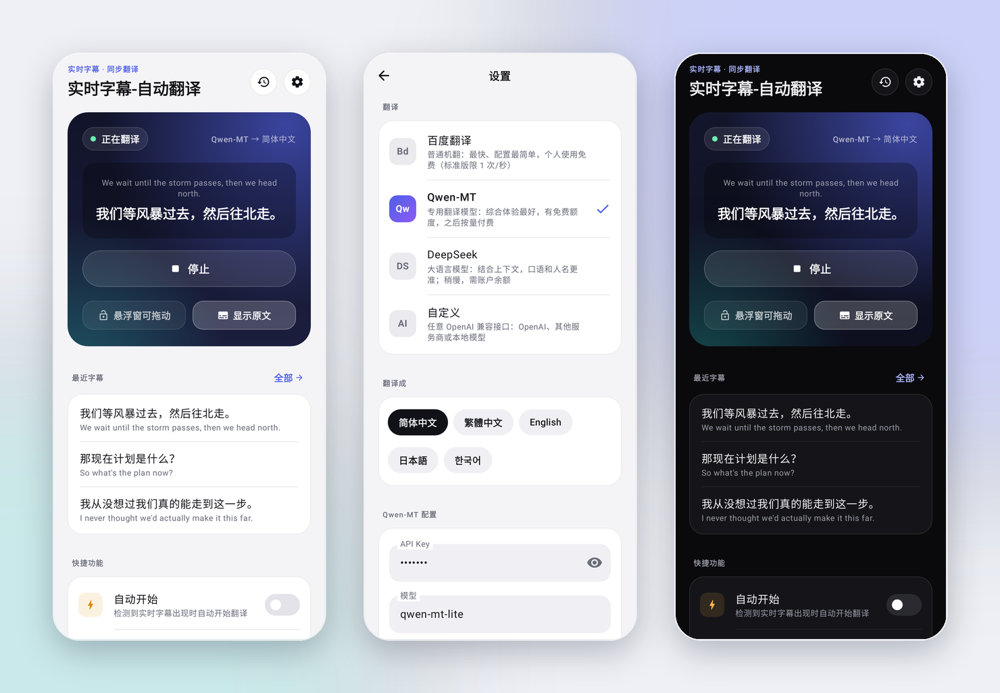

<div align="center">

# 实时字幕 · 同步翻译
### Live Caption Translator

把手机系统「实时字幕」即时翻译成你的语言，以悬浮字幕显示在任意应用上方。<br>
Translate your phone's system Live Caption in real time, as a floating subtitle over any app.


**[中文](#中文) · [English](#english) · [下载 / Download](https://github.com/b1aNaa/samsung-live-caption-translator/releases/latest)**



</div>

---

## 中文

手机自带的「实时字幕」能把任何视频里的语音识别成文字，但不会翻译。本应用通过**无障碍服务直接读取字幕文字**，交给你选择的翻译引擎，再把译文显示在一条可拖动的悬浮字幕上——**不截图、不录屏，DRM 保护的应用（Netflix、Disney+ 等）同样可用。**

### 亮点

- **与原字幕逐行对应**：实时字幕在哪里换行，译文就在哪里换行；悬浮窗高度固定，旧内容从顶部平滑滚走，观感和系统字幕一致
- **快且省**：说完的句子只翻译一次并缓存，只有正在说的那一句随识别结果刷新；新译文到达前旧译文保持显示，不闪烁
- **四种引擎**：百度翻译、Qwen-MT、DeepSeek，以及任意 OpenAI 兼容接口（可接入其他服务商或本地模型）；大模型会参考前文，口语和人名更准确
- **五种目标语言**：简体中文、繁體中文、English、日本語、한국어
- **悬浮字幕可定制**：字号、背景不透明度、同屏行数（默认 4 行）、是否显示原文；位置按屏幕比例记忆，横竖屏自动适配
- **锁定悬浮窗**：锁定后点击直接穿透到视频，不挡播放控件
- **自动开始**：检测到实时字幕出现即开始翻译
- **字幕记录**：本次观看翻译过的内容可回看、一键复制（仅保存在内存中）
- **测试翻译**：设置页一键验证密钥，并显示响应耗时
- **快捷磁贴**、深色模式、中英双语界面

### 适用设备

Android 11 及以上、内置 Google 实时字幕（`com.google.android.as`）的手机：三星 Galaxy S / Note / Z / A 系列中高端机型、Google Pixel 等。大部分国行 ROM（小米、OPPO、vivo 等）不带 Google 实时字幕，无法使用。

### 快速开始

1. **安装**：从 [Releases](https://github.com/b1aNaa/samsung-live-caption-translator/releases/latest) 下载 APK 安装
2. **配置引擎**：设置 → 选择引擎、填写密钥 → 点「测试翻译」确认可用
3. **开启无障碍服务**：首页「准备工作」→ 去开启
   > 侧载安装在 Android 13+ 上开关可能是灰色的：设置 → 应用程序 → 本应用 → ⋮ → 允许受限设置，再回来开启
4. **打开实时字幕**：播放视频时按音量键，点音量条下方的「实时字幕」图标
5. **开始翻译**：点「开始翻译」，或打开「自动开始」

### 翻译引擎

| 引擎 | 类型 | 适合 | 获取密钥 |
|---|---|---|---|
| 百度翻译 | 机器翻译 | 最快、个人使用免费 | [fanyi-api.baidu.com](https://fanyi-api.baidu.com) → 通用文本翻译 |
| Qwen-MT | 专用翻译模型 | 速度与质量最均衡 | [bailian.console.aliyun.com](https://bailian.console.aliyun.com) → API-KEY（支持国际站） |
| DeepSeek | 大语言模型 | 口语、代词、人名更准确 | [platform.deepseek.com](https://platform.deepseek.com) → API keys |
| 自定义 | OpenAI 兼容接口 | 自选服务商或本地模型 | 填写接口地址、密钥与模型名 |

### 隐私与权限

| 权限 | 用途 |
|---|---|
| `INTERNET` | 调用你配置的翻译接口 |
| 无障碍服务 | 读取实时字幕的文字，并显示悬浮字幕（无需「显示在其他应用上层」权限） |

- 字幕文字只发送给你选择的翻译服务，没有统计 SDK、崩溃上报或自建服务器
- 密钥只保存在本机，并排除在云备份与换机迁移之外
- 字幕记录只保存在内存中，关闭应用即清空

### 从源码构建

需要 JDK 17 与 Android SDK（platform 35）。项目自带 Gradle Wrapper：

```bash
./gradlew assembleDebug          # Windows：gradlew.bat assembleDebug
./gradlew testDebugUnitTest      # 单元测试，并把界面渲染到 app/build/screenshots
./gradlew assembleRelease        # R8 压缩的正式包
```

如需签名，在 `local.properties` 中提供 `release.storeFile`、`release.keyAlias`、`release.storePassword`、`release.keyPassword`；未配置时自动跳过。

### 项目结构

| 路径 | 作用 |
|---|---|
| `caption/` | 从无障碍节点树读取字幕，按行整理，切分为翻译单元 |
| `pipeline/` | 防抖、缓存、上下文、错误退避，并把译文按行重组；纯 Kotlin，有完整单元测试 |
| `translate/` | 各翻译引擎，共用一个可取消的 HTTP 客户端，错误统一分类 |
| `overlay/` | 无障碍悬浮字幕 |
| `settings/` | 设置的唯一数据源 |
| `ui/` | Jetpack Compose 界面 |

---

## English

Your phone's built-in Live Caption turns speech in any video into text, but it can't translate it. This app **reads the caption text through an accessibility service**, sends it to the engine you choose, and shows the translation as a draggable floating subtitle — **no screenshots, no screen recording, and it works with DRM-protected apps** such as Netflix and Disney+.

### Highlights

- **Line for line with the original**: the translation breaks exactly where Live Caption does; the overlay keeps a fixed height and older text scrolls off the top, just like the system captions
- **Fast and frugal**: finished sentences are translated once and cached; only the sentence still being spoken is refreshed, and the previous translation stays up until the new one arrives — no flicker
- **Four engines**: Baidu Translate, Qwen-MT, DeepSeek, or any OpenAI-compatible API (other providers or a local model); LLMs see the preceding lines as context
- **Five target languages**: Simplified / Traditional Chinese, English, Japanese, Korean
- **Customisable subtitle**: text size, background opacity, lines on screen (4 by default), original text on/off; position is stored relative to the screen and survives rotation
- **Lock overlay**: touches pass straight through to the video
- **Auto-start** when Live Caption appears
- **History** of what was translated this session, tap to copy (memory only)
- **Test translation** in Settings, with latency
- **Quick Settings tile**, dark mode, Chinese / English UI

### Requirements

Android 11+ with Google Live Caption (`com.google.android.as`): Samsung Galaxy S / Note / Z / A mid-to-high end, Google Pixel, and others. Most China-market ROMs don't ship Google Live Caption.

### Getting started

1. **Install** the APK from [Releases](https://github.com/b1aNaa/samsung-live-caption-translator/releases/latest)
2. **Engine**: Settings → pick an engine, enter its key, tap "Test translation"
3. **Accessibility**: Home → Setup → Enable
   > If the toggle is greyed out (sideloaded, Android 13+): Settings → Apps → this app → ⋮ → Allow restricted settings
4. **Live Caption**: press a volume key while a video plays and tap the Live Caption icon under the slider
5. **Start**: tap "Start translating", or turn on Auto-start

### Engines

| Engine | Type | Best for | Key |
|---|---|---|---|
| Baidu Translate | Machine translation | Speed, free for personal use | [fanyi-api.baidu.com](https://fanyi-api.baidu.com) |
| Qwen-MT | Dedicated MT model | Best balance of speed and quality | [bailian.console.aliyun.com](https://bailian.console.aliyun.com) (international endpoint supported) |
| DeepSeek | Large language model | Slang, pronouns, names | [platform.deepseek.com](https://platform.deepseek.com) |
| Custom | OpenAI-compatible API | Your own provider or local model | Base URL, key and model name |

### Privacy & permissions

Only `INTERNET` and the accessibility service — the subtitle is an accessibility overlay, so no "display over other apps" permission. Caption text goes only to the translation service you choose; there is no analytics, crash reporting or server of our own. Keys stay on the device and are excluded from cloud backup and device transfer; history lives in memory only.

### Build

JDK 17 + Android SDK (platform 35); the Gradle wrapper is included.

```bash
./gradlew assembleDebug
./gradlew testDebugUnitTest   # unit tests + UI renders in app/build/screenshots
./gradlew assembleRelease     # R8-minified build
```

For release signing, set `release.storeFile / keyAlias / storePassword / keyPassword` in `local.properties`.

---

## License

[MIT](LICENSE)
